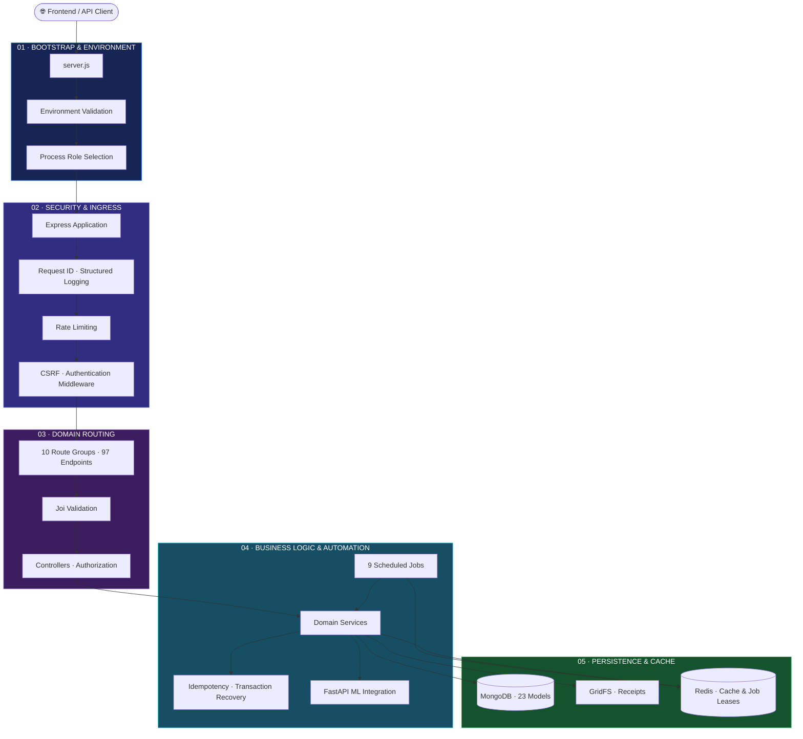
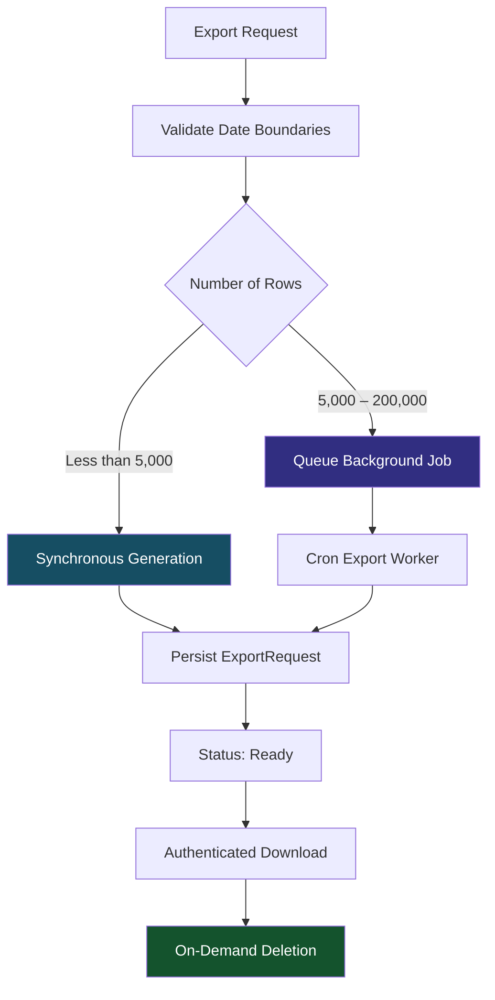
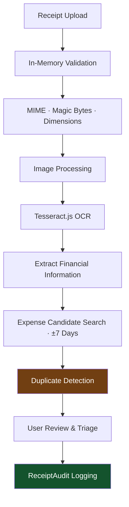
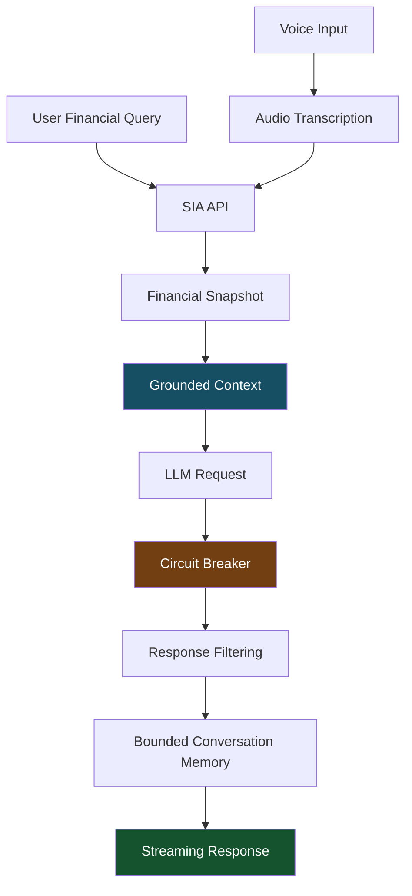

# BALENSIA — Backend Architecture

<p align="center">
  
  <br /><br />
  <strong>A Visual Journey Through the Backend Engineering Behind BALENSIA</strong>
  <br />
  <sub>Interactive architecture visualization · Distributed job processing · Data integrity · Security engineering</sub>
  <br /><br />
  <a href="https://github.com/nareshjo001/expense-manager">
    
  </a>
  
  
  
  
  <br />
  
  
  
</p>

---

## ◈ About This Project

The BALENSIA backend is a resilient Express.js service engineered to power financial operations, transactional integrity, scheduled automation, document processing, and AI-driven financial intelligence.

Built around **Node.js, Express, MongoDB, Redis, and FastAPI**, it provides a centralized service architecture with clearly defined security boundaries, distributed background processing, and reliable data persistence.

The **BALENSIA Backend Architecture Visualizer** transforms this backend ecosystem into an interactive, navigable system map, making it easier to understand how requests travel through the application, how background jobs operate, and how individual services coordinate.

> **Architecture audit:** Maintained against the latest available state of the [BALENSIA repository](https://github.com/nareshjo001/expense-manager) on the `main` branch.

---

## ◈ At a Glance

<table>
<tr>
<td align="center" width="33%">
<h2>97</h2>
<strong>HTTP Endpoints</strong>
<br /><sub>Across 10 route groups</sub>
</td>
<td align="center" width="33%">
<h2>9</h2>
<strong>Cron Modules</strong>
<br /><sub>Distributed background jobs</sub>
</td>
<td align="center" width="33%">
<h2>23</h2>
<strong>MongoDB Models</strong>
<br /><sub>Plus GridFS storage</sub>
</td>
</tr>
<tr>
<td align="center">
<h2>262</h2>
<strong>Test Files</strong>
<br /><sub>Backend test coverage</sub>
</td>
<td align="center">
<h2>2,400+</h2>
<strong>Tests</strong>
<br /><sub>Unit and integration testing</sub>
</td>
<td align="center">
<h2>3</h2>
<strong>Process Roles</strong>
<br /><sub>Web · Worker · All</sub>
</td>
</tr>
</table>

<sub>Metrics reflect the audited implementation, including MongoDB persistence, Redis integration, and background processing.</sub>

---

## ◈ Explore the Architecture

| Section | What You'll Discover |
|:---|:---|
| [01 — System Architecture](#01--system-architecture) | Five-layer backend request architecture |
| [02 — Technology Stack](#02--technology-stack) | Backend infrastructure and technologies |
| [03 — Background Job Engine](#03--scheduled-background-jobs) | Nine cron jobs and distributed Redis leases |
| [04 — Core Workflows](#04--core-end-to-end-workflows) | Exports, receipt OCR, and SIA intelligence |
| [05 — Security & Boundaries](#05--security--architectural-boundaries) | Authentication, isolation, and reliability guarantees |
| [06 — Limitations & Improvements](#06--active-limitations--resolved-improvements) | Operational limits and engineering improvements |
| [07 — Run Locally](#07--run-the-visualizer-locally) | Launching the architecture visualizer |
| [08 — Deployment](#08--github-pages-deployment) | GitHub Pages publishing |

---

# 01 — System Architecture

## The Five-Layer Request Architecture

The BALENSIA backend follows a five-layer architecture, separating environment validation, security, routing, business logic, and persistence.



### Layer 01 — Bootstrap & Environment Gate

<sub>`server.js` · `config/env.js`</sub>

Responsible for initializing the backend and validating its runtime environment before accepting requests.

- Centralized environment validation through `assertValidEnv()`.
- MongoDB connection configuration.
- Required secret validation.
- JWT and refresh-token secret validation (32-character minimum).
- CORS origin validation.
- Process role selection through `PROCESS_ROLE`.

**Supported process roles**

| Role | Responsibility |
|:---|:---|
| `web` | Handles incoming HTTP requests |
| `worker` | Executes scheduled background jobs |
| `all` | Runs both application and background processing |

Scheduled jobs are loaded according to the configured process role.

### Layer 02 — Security & Ingress Protection

<sub>`app.js` · `middleware/`</sub>

Establishes the security boundary for incoming requests.

- Structured JSON logging.
- `X-Request-ID` propagation.
- Global IP-based rate limiting.
- Email-scoped OTP rate limiting.
- Authentication middleware.
- Double-submit CSRF cookie protection.
- Cookie-authenticated route protection.

**Rate-limiting components**

- `authLimiter`
- `otpIssueLimiter`
- `otpVerifyLimiter`

### Layer 03 — Domain Routing & Controllers

<sub>`routes/` · `controllers/`</sub>

Organizes backend functionality into domain-specific API modules.

- 97 HTTP endpoints.
- 10 route groups.
- Joi-based request validation.
- Per-request authorization.
- Validated `userId` extraction from short-lived access JWTs.
- Controller-based request handling.

**Route groups**

| Route Group | Responsibility |
|:---|:---|
| `api` | General application APIs |
| `auth` | Authentication and session management |
| `bill` | Receipt and bill processing |
| `chart` | Financial chart data |
| `expense` | Expense operations |
| `health` | Health and service checks |
| `income` | Income operations |
| `ml` | Machine learning integration |
| `report` | Financial reports |
| `sia` | AI financial assistant |

### Layer 04 — Business Logic & Automation Engine

<sub>`services/` · `cron/`</sub>

Contains the application's core financial logic and automated background processing.

- Idempotent financial transaction processing.
- `PendingSync` conflict recovery.
- Deterministic financial report analysis.
- Spending velocity evaluation.
- Category-shift analysis.
- Financial health scoring.
- Nine scheduled background jobs.
- Push notification retries.
- Export generation and retention management.

### Layer 05 — Persistence & Cache

<sub>`models/` · `utils/redisClient.js`</sub>

Manages durable data storage and optional caching.

- 23 Mongoose models.
- MongoDB schema validation.
- Compound database indexing.
- GridFS `receipts` bucket.
- Optional Redis caching.
- Distributed job leases.
- Graceful Redis degradation.

**Cache strategy**

| Cache Type | TTL |
|:---|:---:|
| View caches | 5 minutes |
| Financial reports | 1 hour |
| Redis degradation window | 5 seconds |

Redis is treated as a disposable cache and coordination layer rather than the source of truth.

---

# 02 — Technology Stack

The infrastructure powering BALENSIA's backend ecosystem.

| Category | Technologies |
|:---|:---|
| Runtime | Node.js |
| Web Framework | Express.js |
| Database | MongoDB |
| ODM | Mongoose |
| File Storage | GridFS |
| Cache & Coordination | Redis |
| Validation | Joi |
| Authentication | JWT, bcrypt |
| Background Processing | node-cron, Redis leases |
| Machine Learning | Python, FastAPI |
| Document Processing | Tesseract.js |
| Image Processing | Sharp |
| Testing | Jest |
| API Communication | REST APIs |

---

# 03 — Scheduled Background Jobs

## The Cron Engine

BALENSIA uses nine isolated background job modules to automate recurring financial operations, file management, retention policies, and notification delivery.

All scheduled jobs use fail-safe distributed Redis leases with the key pattern:

```text
job-lease:<job>
```

This prevents multiple workers in a clustered deployment from executing the same scheduled task concurrently, subject to the lease and clock-synchronization assumptions.

## Background Job Schedule

| Job | Schedule | Purpose |
|:---|:---:|:---|
| `accountDeletionJob` | Daily · 03:00 | Permanently deletes user data after the 14-day grace period |
| `exportCleanup` | Daily · 05:00 | Removes expired exports and updates their records |
| `exportGeneration` | Every 2 min | Generates queued asynchronous exports |
| `feedbackCollector` | Daily · 20:30 | Aggregates category corrections and triggers ML retraining at 100+ pending |
| `importSessionRetention` | Daily · 04:00 | Removes abandoned or expired CSV preview sessions |
| `receiptRetention` | Daily · 06:00 | Removes orphaned or unlinked GridFS receipts older than 90 days |
| `recurringJob` | Daily · 20:30 | Generates expenses due from recurring schedules |
| `retryPush` | Every 15 min | Retries failed push notifications up to 3 total attempts |
| `staleDeviceCleanup` | Daily · 02:00 | Removes inactive or invalid FCM device tokens |

<details>
<summary><strong>01 · Account Deletion Lifecycle</strong></summary>

- Scheduled daily at 03:00.
- Enforces a mandatory 14-day grace period.
- Permanently purges user data after the grace period.

</details>

<details>
<summary><strong>02 · Export Generation & Cleanup</strong></summary>

- Queued exports are processed every two minutes.
- Export artifacts are cleaned up daily.
- Generated export tokens have 24-hour validity.

</details>

<details>
<summary><strong>03 · Feedback Collection</strong></summary>

- Aggregates user category corrections.
- Triggers ML retraining when 100 or more pending corrections are collected.

</details>

<details>
<summary><strong>04 · Receipt & Import Retention</strong></summary>

- Removes abandoned CSV import sessions.
- Cleans up orphaned receipt images older than 90 days.

</details>

<details>
<summary><strong>05 · Recurring Expenses & Push Notifications</strong></summary>

- Automatically creates expenses from recurring schedules.
- Retries failed push payloads.
- Removes invalid Firebase Cloud Messaging device tokens.

</details>

---

# 04 — Core End-to-End Workflows

Three major backend workflows demonstrate how BALENSIA handles data operations, document intelligence, and AI-driven financial assistance.

## 4.1 Data Rights & Export Management

<sub>API: `/api/export`</sub>

The export engine supports both synchronous and asynchronous generation depending on the requested data volume.



**Synchronous exports**

For exports containing fewer than 5,000 rows:

- Generated synchronously.
- Persisted as an `ExportRequest` document.
- Stored with `status: 'ready'`.
- Available for re-download.
- Supports on-demand deletion.

**Asynchronous exports**

For exports containing 5,000 to 200,000 rows:

- Queued for background generation.
- Processed by the export generation cron job.
- Generated artifacts receive 24-hour token validity.
- Export records are updated after processing.

**Export safeguards**

- Mandatory `startDate` and `endDate` boundaries.
- Resilient date parsing through `backend/utils/dateParsing.js`.
- Maximum export ceiling of 200,000 rows.
- Immediate deletion of both database records and physical files.

```http
DELETE /api/export/:id
```

## 4.2 Receipt OCR & Duplicate Triage

<sub>APIs: `/api/bill` · `/api/receipts`</sub>

The receipt-processing pipeline extracts financial information from uploaded images and intelligently matches receipts with existing expenses.



**Processing capabilities**

- In-memory file validation.
- MIME-type verification.
- Magic-byte verification.
- Maximum image dimensions of 20 megapixels.
- Tesseract.js OCR.
- Two OCR timeout attempts of 30 seconds each.
- Automated ±7-day expense candidate matching.
- Exact content hash comparison.
- Probable merchant, date, and amount matching.
- Audit tracking through `ReceiptAudit`.

## 4.3 SIA — AI Financial Intelligence

<sub>API: `/api/sia`</sub>

SIA provides grounded financial assistance through backend-managed financial context and protected LLM communication.



**Key capabilities**

- Grounded financial assistant queries.
- Server-side spending snapshots.
- Circuit-breaker-protected LLM calls.
- Prohibited-phrase filtering.
- Bounded conversation memory.
- Audio transcription.
- Voice-based expense creation.

---

# 05 — Security & Architectural Boundaries

BALENSIA's backend architecture is designed around strict data isolation, controlled authentication, transactional safety, and resilient service operation.

## 5.1 Guaranteed Capabilities

| Area | Implementation |
|:---|:---|
| Mutation safety | Client-generated UUID idempotency keys |
| Duplicate requests | Cached-state replay or HTTP 409 conflict handling |
| Data isolation | Database queries scoped by authenticated `req.userId` |
| Redis reliability | Graceful degradation to direct database queries |
| Account deletion | Two-tier lifecycle with 14-day grace period |
| Password security | bcrypt with cost factor 10 |
| OTP security | SHA-256 digests instead of plaintext OTP storage |

## 5.2 Architectural Non-Goals

The backend deliberately delegates or avoids certain responsibilities.

| Non-Goal | Architectural Decision |
|:---|:---|
| In-process ML training | Delegated to FastAPI ML service |
| Plaintext secret storage | Uses hashing and protected environment secrets |
| WebSocket connection churn | Uses polling and Firebase Cloud Messaging push notifications |

## 5.3 Reliability & Data Protection

**Distributed job coordination**

Redis leases coordinate scheduled job execution across worker instances.

**Transactional safety**

Idempotency keys and `PendingSync` recovery protect financial write operations against duplicate submissions and synchronization conflicts.

**Database isolation**

Authenticated user identity is used to scope database operations, preventing cross-user data access.

**Graceful degradation**

The application can continue operating when Redis is unavailable by falling back to direct database queries.

---

# 06 — Active Limitations & Resolved Improvements

## Active Limitations

| Component | Current Limitation |
|:---|:---|
| Distributed cron leases | Requires synchronized server clocks through NTP |
| Export generation | Maximum request size of 200,000 rows |
| Receipt upload | In-memory upload ceiling of 5 MB |
| Receipt processing | Maximum image dimensions of 20 MP |
| Redis | Cache and coordination capabilities degrade when unavailable |

## Recently Resolved Improvements

<details>
<summary><strong>01 · On-Demand Export Purging</strong></summary>

Introduced `DELETE /api/export/:id` to immediately remove both the export database record and its physical file.

</details>

<details>
<summary><strong>02 · Synchronous Export Persistence</strong></summary>

Synchronous exports now persist ready-state `ExportRequest` records in MongoDB, enabling re-download and lifecycle management.

</details>

<details>
<summary><strong>03 · Resilient Multi-Format Date Parsing</strong></summary>

Centralized date parsing through `backend/utils/dateParsing.js`, supporting legacy and ISO date inputs.

</details>

<details>
<summary><strong>04 · Safe Error Reporting</strong></summary>

Improved error logging with sanitized `errorCode` and `errorSyscall` fields without exposing credentials.

</details>

---

# 07 — Run the Visualizer Locally

The backend architecture visualizer is a standalone static application.

**No npm installation. No build process. No third-party dependencies.**

### Option 1 — Open Directly

Open `index.html` in any modern browser.

### Option 2 — Python HTTP Server

Navigate to the visualizer directory and execute:

```bash
python -m http.server 8080
```

Open the following address:

```text
http://localhost:8080
```

---

# 08 — GitHub Pages Deployment

The visualizer supports static hosting through GitHub Pages.

**Deployment features**

- Relative asset paths.
- Zero external CDN dependencies.
- Zero third-party runtime dependencies.
- GitHub Actions workflow.
- Automated publishing through `.github/workflows/pages.yml`.

Configure GitHub Pages to use the repository's GitHub Actions workflow to enable publishing.

---

# 09 — Technical Standards

## Engineering Standards

| Category | Standard |
|:---|:---|
| Runtime | Node.js |
| Framework | Express.js |
| Markup | HTML5 |
| Styling | CSS3 |
| Scripting | Vanilla JavaScript (ES2022) |
| External Dependencies for Visualizer | Zero |
| Build Tools for Visualizer | None |
| Hosting | GitHub Pages compatible |
| Responsive Support | Desktop, tablet, and mobile |
| Accessibility | Semantic structure and reduced-motion support |

## Visualizer Design Language

The visualizer follows the BALENSIA design language.

- Consistent 4px vertical accent-line heading pattern.
- Accent dimensions: `4px × 24px`.
- Structured typography and spacing.
- Responsive layouts.
- Accessible interactions.
- `prefers-reduced-motion` support.

---

## ◈ Backend Architecture at a Glance

| Architectural Area | Responsibility | Core Technology |
|:---|:---|:---|
| 01 · Bootstrap | Environment validation and process initialization | Node.js |
| 02 · Security | Authentication, rate limiting, CSRF | Express Middleware |
| 03 · Routing | Domain APIs and request validation | Express, Joi |
| 04 · Business Logic | Transactions, automation, ML integration | Services, Cron, FastAPI |
| 05 · Persistence | Durable storage, caching, job coordination | MongoDB, GridFS, Redis |

---

<p align="center">
  <br />
  <strong>BUILT FOR RELIABILITY. ENGINEERED FOR INTELLIGENCE.</strong>
  <br />
  <sub>Designed to document. Built to explore. Engineered for clarity.</sub>
  <br /><br />
  <a href="https://github.com/nareshjo001/expense-manager">
    <strong>Explore the BALENSIA Repository →</strong>
  </a>
  <br /><br />
  <sub>© BALENSIA · Backend Architecture Documentation</sub>
</p>